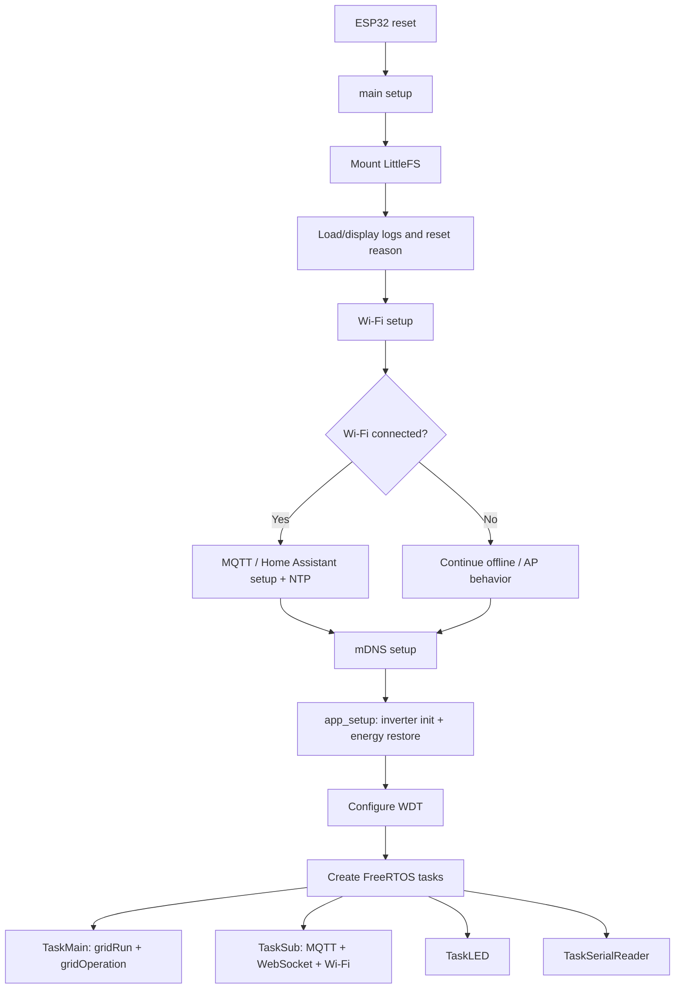
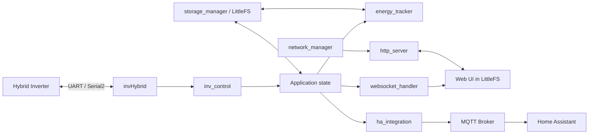

# Hybrid Energy Manager (HEM) — Project Structure & Technology Stack

> เอกสารอ้างอิงโครงสร้างโปรเจกต์, หน้าที่ของแต่ละโมดูล และ Stack สำหรับนำไปตั้งต้นโปรเจกต์ ESP32 ใหม่  
> Last reviewed: 2026-11-04

## 1. Project Identity

| Item | Current value |
|---|---|
| Project | Hybrid Energy Manager (HEM) |
| MCU | ESP32 |
| PlatformIO environment | `esp32dev` |
| Board | Espressif ESP32 Dev Module |
| Framework | Arduino |
| Platform | Espressif32 `6.0.1` (กำหนด `espressif32@~6.0.0`) |
| Arduino-ESP32 | `2.0.6` |
| Filesystem | LittleFS |
| Filesystem source folder | `data/` |
| Partition table | `partitions/ota.csv` |
| Serial monitor | `115200 baud` |
| Inverter UART | Serial2, 2400 baud, 8N1 (ยืนยันจาก project design/README; ตรวจ pin จริงใน `src/invHybrid.h`) |
| Git branch | `main` |
| Git remote | `https://github.com/Artputeye/Hybrid-Energy-Manager.git` |

## 2. Technology Stack

### Firmware / Embedded

| Technology | Version / configuration | Purpose |
|---|---|---|
| PlatformIO | CLI / PlatformIO Core | Build, upload, dependency management |
| Espressif32 platform | 6.0.1 | ESP32 toolchain/platform |
| Arduino-ESP32 | 2.0.6 | Arduino framework |
| FreeRTOS | bundled with ESP32 Arduino core | Concurrent tasks, timers, synchronization |
| LittleFS | bundled | Web assets and persistent files |
| ESPmDNS | bundled | Hostname discovery |
| Update | bundled | OTA firmware update |
| ESPAsyncWebServer | resolved 3.6.0 | HTTP server and async routes |
| AsyncTCP | resolved 3.4.4 | Async TCP backend |
| WiFiManager | 2.0.17 | Wi-Fi provisioning/configuration |
| ArduinoJson | 7.4.1 | JSON parsing and serialization |
| PubSubClient | 2.8.0 | MQTT client |
| Arduino Home Assistant integration | 2.1.0 | Home Assistant MQTT discovery/integration |
| base64 | resolved 1.4.0 | Base64 encoding/decoding |

> เวอร์ชัน resolved เป็นผลจาก PlatformIO build ครั้งล่าสุด ส่วน `platformio.ini` เป็นตัวกำหนด dependency constraints ที่ควบคุมการติดตั้งจริง

### Web Frontend

- HTML5
- CSS3
- Vanilla JavaScript
- WebSocket client
- เสิร์ฟ static assets จาก LittleFS (`data/`)
- แยกไฟล์หน้าเว็บ, stylesheet และ JavaScript ตาม feature/page

ไม่มีหลักฐานจากโครงสร้างปัจจุบันว่าใช้ React, Vue, Angular หรือ frontend bundler

### Developer Tools

- Visual Studio Code / editor ที่รองรับ PlatformIO
- PlatformIO CLI
- Git + GitHub
- Serena MCP สำหรับ code navigation/refactoring/documentation
- Serial terminal สำหรับ hardware debugging

## 3. Current Repository Tree

```text
Hybrid-Energy-Manager/
├── .gitignore
├── .mcp.json
├── README.md
├── platformio.ini
├── upload.txt
├── clear
│
├── backup/                 # สำรองข้อมูล/ไฟล์เก่า (ตรวจเนื้อหาก่อนนำกลับมาใช้)
│
├── data/                   # PlatformIO LittleFS source: Web UI/static files
│   ├── index.html
│   ├── dashboard.html
│   ├── dashboard.css
│   ├── dashboard.js
│   ├── battery.html
│   ├── battery.css
│   ├── battery.js
│   ├── setting.html
│   ├── setting.css
│   ├── setting.js
│   ├── network.html
│   ├── network.css
│   ├── network.js
│   ├── state.html
│   ├── state.css
│   ├── state.js
│   ├── info.html
│   ├── info.css
│   ├── info.js
│   ├── ota.html
│   ├── ota.css
│   ├── ota.js
│   ├── filelist.html
│   ├── filelist.css
│   ├── filelist.js
│   ├── flow.css
│   ├── chart.css
│   └── pic/                # รูปภาพหน้า UI
│
├── Json/                   # JSON configuration/status filesใน repository
│   ├── battery.json
│   ├── networkconfig.json
│   ├── setting.json
│   └── status.json
│
├── partitions/
│   └── ota.csv             # Partition layout สำหรับ OTA
│
└── src/                    # Firmware source (C++)
    ├── main.cpp
    ├── config.cpp / config.h
    ├── app_main.cpp / app_main.h
    ├── invHybrid.cpp / invHybrid.h
    ├── inv_control.cpp / inv_control.h
    ├── serial_handler.cpp / serial_handler.h
    ├── energy_tracker.cpp / energy_tracker.h
    ├── network_manager.cpp / network_manager.h
    ├── http_server.cpp / http_server.h
    ├── websocket_handler.cpp / websocket_handler.h
    ├── ha_integration.cpp / ha_integration.h
    ├── storage_manager.cpp / storage_manager.h
    ├── time_sync.cpp / time_sync.h
    ├── ota_update.cpp / ota_update.h
    ├── logger.cpp / logger.h
    └── ui_indicator.cpp / ui_indicator.h
```

## 4. Firmware Module Responsibilities

| Module | Responsibility | Change carefully when |
|---|---|---|
| `main.cpp` | Arduino setup/loop, global MQTT objects, boot sequence, FreeRTOS task creation and task loops | Changing startup order, task affinity/priority, WDT, global object lifecycle |
| `config.h/.cpp` | Common includes, macros, global declarations, device/network settings | Adding shared state, changing pin/board definitions or include dependencies |
| `app_main.cpp/.h` | Application initialization and main business loop | Changing order of inverter init, energy restore, grid control |
| `invHybrid.cpp/.h` | Inverter transport/protocol interface and inverter data model | UART pins, baud, command frame, response framing |
| `inv_control.cpp/.h` | Inverter command handling, grid operation, expense/solar calculations | Register writes, thresholds, safety limits, tariffs |
| `serial_handler.cpp/.h` | Commands received through USB Serial/debug interface | Serial console command syntax |
| `energy_tracker.cpp/.h` | Energy history accumulation, bucket rollover and persistence coordination | kWh math, day/month rollover, restore behavior |
| `network_manager.cpp/.h` | Wi-Fi setup, AP/STA mode, IP configuration, reconnect and AP client listing | Credentials, reconnect state machine, network events |
| `http_server.cpp/.h` | Async HTTP routes, APIs and static file serving | API contract, request validation, auth, route registration |
| `websocket_handler.cpp/.h` | WebSocket lifecycle, telemetry serialization, client notification | JSON schema, Base64 payload, concurrency/shared state |
| `ha_integration.cpp/.h` | MQTT lifecycle, HA discovery and state publication | Entity IDs, topics, units, device classes, reconnect |
| `storage_manager.cpp/.h` | LittleFS file helpers, JSON load/save and application persistence | File paths, JSON schema, format/recovery behavior |
| `time_sync.cpp/.h` | NTP synchronization, cached date/time, resync timer/task | Timezone, rollover, time-not-synced behavior |
| `ota_update.cpp/.h` | Firmware/filesystem OTA and file manager endpoints | Partition sizes, upload validation, reboot behavior |
| `logger.cpp/.h` | Persistent/serial logging and reset diagnostics | Log volume, flash wear, boot diagnostics |
| `ui_indicator.cpp/.h` | Status LED patterns | Pin mapping and status semantics |

### Current task model observed in `main.cpp`

- `TaskMain` — Core 0, priority 3, stack 8192; calls `app_loop()` and feeds WDT.
- `TaskSub` — Core 1, priority 1, stack 8192; calls MQTT loop, WebSocket processing, AP mode check and Wi-Fi keep-alive; feeds WDT.
- `TaskLED` — Core 1, priority 1, stack 2048; updates LED pattern.
- `TaskSerialReader` — Core 0, priority 1, stack 4096; reads USB Serial commands.
- Arduino `loop()` deletes its own task; main work is FreeRTOS task-driven.

This is the current implementation, not necessarily the final recommended architecture. Before changing it, map shared data ownership and verify stack/WDT behavior on hardware.

## 5. Boot and Runtime Flow



## 6. Data Flow



## 7. Configuration and Filesystem

### PlatformIO configuration

Current key settings from `platformio.ini`:

```ini
[env:esp32dev]
platform = espressif32@~6.0.0
board = esp32dev
framework = arduino
monitor_speed = 115200
board_build.partitions = partitions/ota.csv
board_build.filesystem = littlefs
```

Libraries are declared in `lib_deps`; use PlatformIO dependency resolution as the source of truth.

### Important distinction: `data/` vs `Json/`

- `data/` is configured as PlatformIO's LittleFS image source.
- `Json/` is a separate repository folder containing JSON files.
- Do not assume files in `Json/` are automatically flashed to LittleFS. Confirm the copy/generation/runtime path in storage code before changing deployment.
- Runtime LittleFS paths and repository paths must be documented explicitly once verified.

### Security warning

Configuration JSON can contain Wi-Fi and MQTT credentials. Treat them as secrets:

- Do not copy real credentials into templates, documentation, examples, issue reports or commits.
- Use placeholder values in sample files.
- Keep local secret files out of Git using an explicit ignore rule.
- Rotate credentials that have already been committed to a shared repository.
- Never print passwords in serial logs or Web UI responses.

## 8. Web UI Pages

| Page group | Files | Responsibility (inferred from filenames/UI) |
|---|---|---|
| Main/dashboard | `index.html`, `dashboard.*` | Main monitoring dashboard |
| Battery | `battery.*` | Battery configuration/status |
| Settings | `setting.*` | Inverter and energy/cost settings |
| Network | `network.*` | Wi-Fi, IP and MQTT settings |
| State | `state.*` | Inverter/system state |
| Information | `info.*` | Device information/command terminal |
| OTA | `ota.*` | Firmware/filesystem update |
| File list | `filelist.*` | LittleFS file management |
| Shared assets | `chart.css`, `flow.css`, `pic/` | Charts, layout and images |

Frontend files should call documented backend APIs; avoid duplicating business rules in JavaScript and C++.

## 9. Protocol and Integration Reference

### Inverter serial

- Transport: ESP32 Serial2
- Current documented link: 2400 baud, 8 data bits, no parity, 1 stop bit (8N1)
- Query commands documented in README: `QPIGS`, `QPIRI`, `QPIWS`, `QFLAG`, `QDI`, `QMOD`
- Confirm command checksum, exact response lengths, field indexes and pin mapping against the current `invHybrid.cpp/.h` implementation and the inverter manual before extending.

### HTTP / WebSocket / MQTT

- WebSocket path documented in README: `/ws`
- HTTP APIs documented in README: `/getsetting`, `/savesetting`, `/getbattsetting`, `/getnetworkconfig`
- OTA endpoints documented in README: `/otafirmware`, `/otalittlefs`
- MQTT/HA: `ha_integration.cpp` owns discovery and state publishing.
- This list is a starting index, not a complete route/topic specification. Update it from the route and publish implementations.

## 10. Starter Template Recommendations for New ESP32 Projects

Use this as a reusable baseline, then remove modules that the new project does not need.

```text
New-ESP32-Project/
├── README.md
├── plan.md                 # Roadmap, current status, acceptance criteria
├── struc.md                # Stack, structure, architecture, module ownership
├── platformio.ini
├── partitions/
│   └── ota.csv             # Optional, only if OTA is required
├── data/                   # Optional LittleFS web assets/config templates
├── config/                 # Optional sample config; never put live secrets here
├── test/                   # Unit/integration tests
└── src/
    ├── main.cpp
    ├── config.h
    ├── app_main.cpp/.h
    ├── network_manager.cpp/.h
    ├── storage_manager.cpp/.h
    ├── logger.cpp/.h
    └── feature modules...
```

### New project setup checklist

1. Create Git repository and initial README.
2. Choose exact board and PlatformIO platform/framework versions.
3. Create `platformio.ini` and pin critical dependencies.
4. Define pin map, electrical interface and hardware safety constraints.
5. Separate common configuration, hardware drivers, application logic and service modules.
6. Define JSON schema and filesystem deployment flow before storing persistent state.
7. Define task ownership and inter-task communication before creating multiple FreeRTOS tasks.
8. Add build/test instructions and a minimal smoke test.
9. Add `plan.md` with milestone/checklist and `struc.md` with module map.
10. Ensure credentials, private keys and local build artifacts are excluded from Git.

## 11. Reference Commands

```powershell
pio run
pio run --target upload
pio run --target uploadfs
pio device monitor -b 115200
pio run --target clean
pio run -t inspect

git status --short --branch
git diff
```

## 12. Maintenance Rules

- Update this document whenever modules are added/removed or the stack changes.
- Update `plan.md` when work is completed, deferred or newly discovered.
- Keep version numbers aligned with `platformio.ini` and the actual successful build output.
- Mark assumptions as assumptions until verified in source or hardware.
- Do not document credentials, tokens, private broker addresses or other secrets.
- Preserve the existing public interfaces unless the change includes all required call-site updates.
